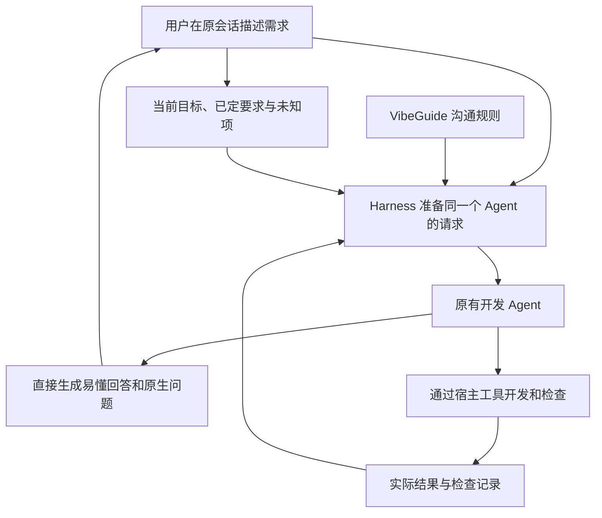

# VibeGuide 首版开发规格

日期：2026-10-15。本文为开发前规格快照，落实[原生对话设计](CONVERSATION_FIRST_DESIGN.md)，取代旧侧栏工程结构。2026-10-18 已按用户指示开始实现；文中“未编写”等表述记录当时阶段，当前完成范围以[开发说明](DEVELOPMENT.md)为准。

2026-10-20 重梳后的功能建议与开发顺序见[产品设计](PRODUCT_DESIGN.md)和[实施计划](DELIVERY_PLAN.md)。本文保留历史规格；新增记录与事件接口仍需结合当前宿主验证。

## 1. 要交付的东西

**一个 DeepSeek Harness 插件包、一份配套 Agent preset、一套可维护的沟通规则，以及验证它们的评测案例。**

对用户的承诺：使用 VibeGuide 的会话中，开发 AI 的回答、方案、提问和结果说明直接面向非技术用户；用户仍在原生会话中提出需求、作出决定和检查成果。

| 交付部分 | 建议形式 | 负责什么 |
| --- | --- | --- |
| 开发协作规则 | Markdown 文本，随包版本管理 | 如何讲方案、何时提问、怎样说明影响和验证结果 |
| Harness 接入 | 一个 TypeScript 插件包 | 在指定 Agent 作答前装载规则与任务事实，管理生命周期 |
| 会话配置 | Harness Agent preset 配置 | 在现有开发能力上启用 VibeGuide，保留模型、工具和权限配置 |
| 任务上下文 | 小型会话记录与来源引用 | 保留目标、明确要求、决定和未知项，供后续生成使用 |
| 效果评测 | 场景、期望行为、失败条件与运行记录 | 检查是否听得懂、问对问题、保留原意 |

首轮先验证规则确实改变同一个 Agent 的输出，再补齐长会话与恢复的可靠性。首版复用原生聊天、提问、工具记录和可用的成果入口；独立前端、默认侧栏、第二解释模型、逐句输出翻译、完整代码地图和跨宿主适配均不属于首版。

## 2. 一次运行怎样发生

图表示产品职责，不是已实现的 API。规则在生成前参与；模型、文件编辑和权限仍由 Harness 管理。原生问题由同一个 Agent 直接使用日常语言填写，无须事后把译文再映射回技术选项。工具原始结果保持原样，面向用户的说明准确表达其实际含义。

## 3. 沟通规则写到什么程度

规则要有适用条件、正反例和边界，不能只有“请用通俗语言回答”。

| 情境 | 必须发生 | 典型失败 |
| --- | --- | --- |
| 问能不能做 | 区分通用实现路径、本项目已验证能力和缺失条件 | 未检查便保证一定能做，或暂时受阻便宣布做不到 |
| 提出方案 | 讲使用过程、范围、关键假设和下一个可体验成果 | 堆砌技术栈，让用户为陌生框架投票 |
| 需要选择 | 只问缺少且会改变结果的业务信息，解释后果，允许自由表达 | 询问已回答的问题，将实现细节全部转嫁给用户 |
| 常规开发 | 在已有范围和授权内推进，在有意义的节点简短说明 | 每次改样式都请批，逐条工具日志生成长解释 |
| 需求变化 | 保留新要求，指出具体冲突，只澄清必要部分 | 忽略新要求，或将所有旧决定全部重新询问 |
| 出错或受阻 | 说明没成功的部分、实际影响和下一步 | 原样抛出技术错误，或为了流畅隐藏失败 |
| 宣布完成 | 讲实际变化、检查依据、未完成项和可操作验收 | 把界面示意当功能完成，把局部测试当全部正确 |
| 用户要技术细节 | 提供准确细节，联系当前目标解释 | 强制简化而妨碍用户学习或核实 |

少量稳定核心规则与场景案例分开维护。简单修改可只用一句话说明，不强制统一长模板。不假设非技术用户缺少业务判断能力；容易理解不等于删除代价、限制或未知项。

## 4. 模块与实现约束

### 4.1 规则装载

拟使用独立命名的提示 section，在指定 Agent 作用域内添加规则。保留宿主原有身份、工具指导与权限上下文，不替换整个系统提示。静态规则与动态任务事实分开，控制输入长度并记录规则版本。

官方固定提交提供 `ctx.systemPrompt.section` 及 Agent 作用域贡献，按模型步骤参与组装。外部插件实际加载和卸载仍待验证。[官方提示机制](https://github.com/deepseek-ai/deepseek-harness/blob/d743267388641bc76f17c45ce8b4c231aed1d32c/packages/core/system-prompt/README.md)

### 4.2 会话入口与生命周期

拟提供一个基于现有开发配置的 VibeGuide preset。第一轮支持创建新会话；现有会话即时切换不作首版承诺。目标版本若已有可用的 preset 选择界面就复用，实际可见入口须在安装中确认。

官方 preset 用配置声明子插件，修改影响后续创建的 Agent。退出和配置更新必须结合该生命周期验证，不能沿用旧 HTML 开关的即时切换假设。[官方 preset 文档](https://github.com/deepseek-ai/deepseek-harness/blob/d743267388641bc76f17c45ce8b4c231aed1d32c/packages/preset/agent-preset/README.md)

### 4.3 当前任务记录

最小接入实验先复用原会话历史。可分发版本需要通过长对话、压缩和恢复测试；必要时补充以下记录。名称为 VibeGuide 拟议契约，并非已有宿主 API。

| 记录 | 最少内容 |
| --- | --- |
| 当前任务 | 会话身份、目标、范围、目标版本、来源消息 |
| 明确要求与决定 | 用户原话或忠实摘要、来源、适用版本、是否已被更新 |
| 假设与未知项 | AI 暂定理解、缺失条件、下一项检查；与用户要求分开 |
| 验收依据索引 | 对应要求、实际工具或用户报告来源、适用版本、未测或过期状态 |

它是一份可追溯摘要，不另建聊天数据库或全项目知识图谱。拟议更新方法：同一个 Agent 在需求变化时提出结构化更新，插件校验会话、来源和版本后保存；如需内部记录工具，接口在技术验证中锁定，不假称宿主已有。

程序能验证来源存在和版本匹配，不能由此保证语义正确。用户原话、模型推测、工具结果保留不同来源类型；新要求不得静默覆盖无关决定。记录业务决定不扩大宿主权限。

持久化优先使用经验证的宿主机制；不足时再选插件私有本地文件，并锁定原子写入、并发与隔离策略。读取失败不提供未经核实的摘要。项目文本及工具输出作为事实资料处理，不提升为沟通规则或用户指令。

### 4.4 结果说明与可靠性

复用原生执行结果，把有来源的事实交给原 Agent 解释。首版只承诺固定版本下已验证的事件范围，缺失结果保持未知。

完成报告区分计划、实际变更、运行过的检查与用户报告。检查关联适用版本，版本变化后不得把旧记录当作当前结果。采用保守的过期规则，不提前建设通用审计平台。

提示规则只能引导模型。首版用固定案例和用户试用评估输出，模型自检仅作补充，不宣称保证每次回答正确。开发诊断记录规则版本、作用会话、必要来源与实测额外用量，不把这些实现字段放进正常用户对话。

## 5. 拟议工程布局

以下是未来文件职责，本轮不创建这些代码、配置或技能文件。

| 位置 | 以后放什么 |
| --- | --- |
| `src/index.ts` | 插件入口、配置和生命周期 |
| `src/policy/` | 沟通规则装载与版本 |
| `src/context/` | 当前任务记录、更新校验、生成前上下文 |
| `src/host/` | 固定版本的 Harness 适配与来源关联 |
| `prompts/` | 可维护的沟通规则与按需示例 |
| `presets/` | VibeGuide 会话配置和安装样例 |
| `evals/` | 对话场景、评分标准、固定输入及结果 |
| `tests/` | 作用域、生命周期、版本、恢复与原生问答集成测试 |
| `docs/` | 使用说明、兼容版本、开发规格与已知限制 |

建议 TypeScript 单包，遵循目标 Harness 版本的插件打包方式；具体依赖和构建命令在实际加载验证后锁定。无独立前端框架或数据库服务的前置要求。

## 6. 开发顺序

| 阶段 | 交付 | 退出条件 |
| --- | --- | --- |
| A 行为规格 | 核心规则、正反例、固定评测场景 | 第一份回答就能按用户目标评审，无须旁边再解释 |
| B 最小接入 | 固定宿主版本、插件、preset、加载记录 | 新会话生效，其他会话不受影响；保留工具与权限；可移除配置 |
| C 连续任务 | 从零开发与已有应用修改各一个完整任务，必要的上下文记录 | 长对话、需求变化和恢复后保留关键要求；失败与未测准确 |
| D 对照评测 | 原生、简单白话提示、VibeGuide 三组对照与用户观察 | 减少误解或遗漏，不增加无效确认和阅读负担 |
| E 可安装交付 | 固定版本打包、安装/卸载和兼容说明 | 干净配置可复现，关键验收通过，限制可追踪 |

A 阶段可用 skill 做内容实验。官方支持用户 `/name` 注入完整技能指令，但一次技能加载不等于已验证的持续每步规则。[官方 skill 机制](https://github.com/deepseek-ai/deepseek-harness/blob/d743267388641bc76f17c45ce8b4c231aed1d32c/packages/skill/tool-skill/README.md)

## 7. 首轮必须检验的十个场景

1. 从零做公司网站：先讲结果，缺资料明确占位，常规实现不反复请批。
2. 已有项目的小改动：理解当前行为，不把用户送回完整新手向导。
3. 同事更新案例：询问未明确的发布职责，避免让用户比较技术栈。
4. 已明确审核要求：后续继续保留，不重复问或擅自改成直接发布。
5. 新功能有外部依赖：先核对条件，不保证全部可行或编造费用。
6. 方案遗漏重要要求：指出并补齐，不能只因语言通俗就接受遗漏。
7. 工具失败或权限被拒：准确说明没完成的部分，不把调用发出当作成功。
8. 测试通过但场景未覆盖：保留未验证部分，不宣布全部可靠。
9. 长对话、恢复和目标变更：没有串会话、误记决定或复用过期检查。
10. 用户主动问技术细节：准确解释，之后继续按当下需要沟通。

每个场景预先写明目标、事实、可接受行为和严重失败条件。用同模型、同项目状态比较；对照组允许正常追问“说得通俗一点”。固定场景重复生成，保留逐次失败，不只挑最好回答。

人工评估关注用户能否预测选择后果、发现遗漏、知道下一步和保留原意。记录额外追问、无效确认、阅读负担、时延与用量；术语少、信心高或模型自评分高不能单独算成功。

试用覆盖从零开始与已有项目两类，小样本用于迭代，不宣布普遍提升比例。若简单白话提示已达到同样效果，保持轻量交付，继续核实持续插件的增量价值。

## 8. 开工前待核实

- 固定提交只是研究基准；首次加载前核对实际宿主版本与分发格式。
- 外部插件如何进入保留完整开发能力的 preset，以及实际可见的选择入口。
- 压缩、恢复和多 Agent 场景下的作用域与来源。先验收主 Agent 面向用户的汇总，不承诺改写所有子 Agent 原始输出。
- 存储、历史引用、工具结果和项目版本是否有适用的公开接口。缺少权威信息时减少承诺，不依赖私有 DOM 或伪造状态。
- 输入长度、成本和时延的实测变化；本地插件不等于本地模型推理。

本轮仅形成开发规格，没有创建源代码、安装依赖、启动服务或修改 HTML。
