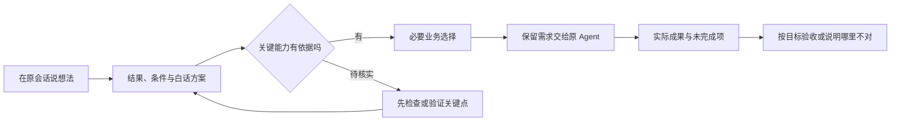

# VibeGuide 交互设计：在原会话中理解并掌握开发

> 2026-10-14 方向修订：用户希望 AI 的回答本身让非技术人员看懂。最新设计见 [原生对话设计](CONVERSATION_FIRST_DESIGN.md)。下文关于“技术原题 + 旁边解释／侧栏”的主交互已被替代；既有用户目标、证据和意图保留要求继续适用。

日期：2026-10-14。状态：待用户验证的 DeepSeek Harness 集成设计稿，不是已实现功能。依据见 [用户痛点调研](USER_RESEARCH.md)，宿主能力边界见 [技术调研](RESEARCH.md)。

## 1. 核心体验

用户继续在 DeepSeek Harness 的原会话里说自己想做什么。VibeGuide 帮他在开工前了解结果与条件，在关键选择时表达真实需求，完成后核对结果。用户不需要先学一套新命令或再向第二个聊天助手介绍项目。

页面以宿主为主体：左侧是 Harness 的工作区与会话导航，中间保留唯一的宿主对话和输入框。VibeGuide 只提供消息附加解释、当前问题的白话说明，以及宿主右侧默认关闭的非模态 VibeGuide 标签页；它没有独立项目导航、聊天输入框或另一份会话。

最短路径：**说想法 → 看懂方案 → 回答真正需要自己决定的问题 → 看阶段成果 → 验收。** 系统结构和技术细节可以展开，不要求用户先学习。



该流程是产品体验，不意味着五个独立页面，也不意味着每个节点都弹窗或要求确认。HTML 原型中的五个场景只放在产品之外的“原型演示控制”选择器中；切换场景不是导航项目、发送消息或完成任务。已表达的需求直接保留；常规实现和验证由 Agent 在既有授权与范围内推进。只有改变产品行为、费用责任或其他重要约束时才询问；宿主原生权限仍独立处理。

## 2. 四种形态的比较

以下为设计推断，需用相同内容对照测试；不是已验证的用户偏好排名。

| 形态 | 上下文与输入 | 回答与打断 | 窄屏/键盘 | 采用方式 |
|---|---|---|---|---|
| 原消息旁短卡 | 紧邻方案；问题解释附在宿主输入区的原生待答问题旁 | 可绑定原题；过度自动展开会刷屏 | 单列适配；明确焦点顺序 | 目标默认入口：简短说明或“看懂这一步”，不另设发送按钮 |
| 按需侧栏 | 宿主右侧非模态标签页，可边看原文边看目标 | 共享同一问题与草稿；发送仍通过原生问题 | 窄屏改单列抽屉，关闭后回到触发按钮 | 默认关闭，用于长方案、当前任务、决定与依据 |
| 独立聊天助手 | 需要重新搬运项目，容易形成两份目标 | 回传常要复制，可能答错会话 | 独立页面容易排版，但多一次切换 | 不采用；接入受限时仍在宿主内展示可复制说明 |
| 全屏新手向导 | 初次进入清晰；频繁回到向导会割裂工作 | 容易把全部选择前置、增加流程 | 单列友好；应能退出并保留草稿 | 只用于必要安装/选项目帮助，允许跳过已知步骤 |

采用组合：**Harness 原会话 + 简短情境说明 + 按需展开宿主侧栏**。默认不常驻大面板，不另开聊天窗口。首次启用时提供“自动解释关键步骤 / 需要时再解释”，选择持久保存，可随时修改。引导模式自动提供短说明，避免让新手每次重新输入“用人话解释”；它不自动选择答案。用户可以关闭解释或禁用插件，原生问题、共享回复草稿和宿主对话继续可用。

可发现性：主输入区附近保留清楚的“VibeGuide”入口，打开后是“这能做吗 / 看懂这一步 / 哪里不对 / 查看当前目标”。不要求记住 `/guide` 等命令；快捷键是可选项，须与宿主现有快捷键核对。

## 3. 开工前：功能可行性与白话方案

对“能不能实现”，先区分三种依据：一般技术路径可行、当前项目已有证据、仍依赖未知条件。没有检查过的项目不显示“已确认可实现”，接口能调用一次也不能证明整项功能可靠。

首次描述只补会改变方案的缺项，例如谁使用、希望看到什么结果、明确不能发生什么。已有会话里讲过的不再问。系统生成的假设可编辑，不当成用户说过的事实。

示例为虚构场景，尚未执行任何检查：

```text
你：我想让客户上传图片，自动识别信息，再由我确认入库。

VibeGuide · 开工前看一眼
预期使用：上传图片 → 看到识别草稿 → 你修改并确认 → 保存记录

原则上有实现路径；当前项目的接入条件尚未检查。
关键未知：你的真实图片能识别到什么程度，是否允许交给外部服务处理。
本次不包含：识别后未经确认就自动保存。

建议下一步：用不含私人信息的样例，先验证“识别草稿”这一步。
结果将说明识别对了哪些字段、错了哪些；不代表所有图片都可靠。

[放入当前会话草稿] [修改预期效果] [看依据与技术方案]
```

“放入当前会话草稿”只将已显示的范围填入宿主输入框，由宿主的发送按钮提交；不会另开会话或静默覆盖用户已有草稿。若它对应当前待回答问题，则更新该问题的同一份回复草稿。有需要确认的外部传输或付费，继续走宿主授权，不能捆绑在一句“我同意方案”里。缺少凭据/依赖属于当前受阻，不应一律宣布功能做不到。小验证应使用有限样例、独立临时区域或项目支持的隔离方式，并事先写明判断条件和不涉及的范围。

完整 plan 首屏仅呈现：完成后的实际流程、本次包含与不含、重要前提/费用责任、关键未确定项、下一个可展示成果。技术栈折叠为“这套方案为什么适合当前目标”，按角色解释页面、数据保存、外部服务；不让用户从陌生框架名单里凭感觉选。

示意图、模拟预览和实际运行截图必须标明来源。没有运行证据的示意不能显示为“已完成”。没有费用依据时显示未确定，不能用虚构报价或工作天数制造确定感。

## 4. AI 提问时：一次理解，一次明确发送

原问题：“先在浏览器本地保存报名，还是增加服务端存储支持共享？”

原生待答问题放在宿主输入区，完整保留原文、全部原选项和一个原生发送按钮。白话解释与原生问题共用候选选项及自定义回复草稿；两处改选同步，不能形成两份答案。VibeGuide 卡片和右栏没有第二个发送入口。

```text
DeepSeek Harness · 当前待回答问题
先在浏览器本地保存报名，还是增加服务端存储支持共享？
原选项：浏览器本地保存 / 增加服务端存储支持共享

VibeGuide · 这道题的白话说明
这道题决定：大家的报名是否汇总在一起。
你之前说：朋友用各自手机报名，你要看到完整名单。

先在这台设备试用
  适合演示；各人的浏览器不会自动共享报名。

让大家的报名汇总给我
  符合多人报名目标；还需确定名单可见范围与部署条件。

共享回复草稿：[朋友手机报名；仅我能看到全部名单。]
将发送：“需要共享报名和组织者名单权限，请据此提出方案。”

[发送回复（宿主唯一入口）] [这些都不符合，修改草稿]
```

选好需求后，只需点击原生问题的发送按钮，不再额外弹同内容确认框。用户自由输入时，紧邻按钮显示完整或可展开的发送内容。没有选择不自动发送，默认焦点不意味着批准。原选项超过三个时完整可达，不能因版式限制偷偷删掉选项。

推荐必须来自已知目标；用户需求不在原选项内时请求新方案，不伪造已选标签。术语可点开，但解释必须接回当前后果。普通技术细节在已有约束内可以交给 AI 推荐默认，不将所有实现问题转嫁给用户。

收到宿主确认后显示回执：“已回复这道问题：共享报名，名单仅组织者可见。”原生问题和解释同时变为已答只读状态，不能重复提交；这里记录意图，不声称已实现权限。用户改主意可点击“更改要求”，将新要求带入当前宿主会话草稿后发送；不重新打开旧题，也不把修改记录说成撤回已经执行的操作。

## 5. 开发中：随时知道下一步属于谁

收起的当前任务只保留目标、一句状态、下一个成果，例如：“正在调整名额规则；下一步用第21次报名检查是否拒绝。”日志按需展开。

| 状态 | 用户应看到的信息 |
|---|---|
| AI正在处理 | 已观察的最近动作、时间与当前任务；不知道完整进度时不编百分比 |
| 等你回答 | 待决定的问题和原题入口，说明不回答会影响哪一步 |
| 等待宿主授权 | 原生授权入口、请求对象与范围；VibeGuide不替你放行 |
| 需要排查 | 已知失败与下一条可核对行动；不把推测写成确定原因 |
| 暂未收到状态 | 最后事件时间与连接状态；静默不等于卡死 |
| 本阶段结束 | 实际变化、检查结果、待验收和未完成内容 |

已经决定不做候补，AI方案又加了候补时，指出“新增内容与你之前的范围不同”。如果宿主支持执行前观察，在该任务继续前处理这一分歧；如果只能事后收到事件，就显示已发生变化并协助纠正，不能声称已经拦截。

不会因每个重命名、格式调整或测试都要求用户确认。重要选择留下记录；计划里的普通步骤可自动推进。

## 6. 完成后：用自己熟悉的操作验收

```text
你的目标：最多接收20人，满额后停止报名。
实际记录：名额规则有改动；针对当前版本的规则测试通过。
还没确认：页面操作是否符合预期；多人同时提交是否正确。

试一下：第20人提交应该成功；第21人应看到“名额已满”。
检查名单：第21人的记录不应被保存。

[打开预览] [记录我的检查结果] [哪里不对] [查看依据]
```

实际产品由真实结果填充。测试、用户报告和未检查分列；代码变更后旧验收标过期。“哪里不对”带当前目标和相关证据，让用户只补“我做了什么、看到什么、原本希望什么”。无需复述整个项目。发送诊断前可预览，不自动外发给其他服务或顾问。

## 7. 宿主接入：体验目标和实际能力分开

| 接入层级 | 条件满足后的体验 | 技术验证失败时 |
|---|---|---|
| 结构化问题 + 支持的UI扩展 + 原生草稿/选择同步 | 原位解释或同题侧栏，保留问题版本，统一由原生问题发送 | 保留原生问题可用，停止辅助写入；不能两个入口抢答 |
| 只有侧栏扩展和问题事件 | 当前问题自动带入按需面板；不能同步时只解释并提供可复制文本 | 保留目标与草稿；明确哪些问题未接入，不冒充已选中或已回复 |
| 普通聊天 plan / 回答 | 用户选中或粘贴后辅助；引导模板可请求 Agent 主动给白话计划 | 不宣称拦截所有消息，不默默改变原回答 |
| 不能取得原题身份或不能回答 | 展示原文、解释与可复制回答，标“尚未发送” | 用户粘回宿主；无发送证据时不标已回复 |

首版选择集成在 DeepSeek Harness 内。现有调研有侧栏和问答协议的源码依据，但第三方插件能否原位增强既有问答 UI、同步原生候选与草稿，以及禁用后保留宿主状态，仍需真实 spike。Codex 适配未核实，不属于本轮原型。**HTML 展示的是 Harness 集成概念；原位短卡和共享状态都是待验证的设计目标，不能把宿主外壳画面当成已真实接入或已存在 API。**

多个窗口共享同一问题状态；原生已答、取消、过期，或问题/目标/适用方案版本更新后旧按钮失效，保留草稿并重新核对。发送结果未知先查询/核对，不重复提交。切会话保留草稿但不会把答案带到另一题。

无鼠标也能打开、阅读、修改和发送；发送动作与关闭分开。窄屏侧栏变单列抽屉，保留来源摘要、滚动位置与草稿，关闭回原消息。状态同时有文字，不依赖颜色、悬停或动画。解释加载期间原题保持可访问。

## 8. 首轮五个可评审案例

以下技术提问均为设计构造案例，不能伪称真实访谈记录；实际测试采用等价题避免学习效应。

| 原问题 / 场景 | 用户事先目标 | 合格响应的关键 | 不合格响应 |
|---|---|---|---|
| 本地保存还是增加共享服务？ | 各自手机报名，组织者看全名单 | 区分共享、保存位置、访问权限；请求满足约束的方案 | 只选“云数据库”，默认所有人能看名单 |
| 图片识别后直接写入，还是人工确认？ | 不要把误识别的数据自动存为正式记录 | 展示识别草稿→确认→保存；用代表样例验证局部能力 | “AI很准所以自动写入”，或试一张就保证可靠 |
| plan只做提交页、数据库和成功提示 | 满20人即关闭，组织者能导出 | 指出计划漏了上限与导出；不要求用户审代码才发现 | 因技术栈完整就标“符合需求” |
| 同步发送所有提醒还是使用队列？ | 点击后知道谁已收到，失败可重试 | 解释发送中的反馈、失败记录与重试；保留服务限制未知 | 将“队列”翻成一定即时或保证送达 |
| 建议增加登录系统和完整后台 | 仅给自己本机试用，下周再决定多人版 | 判断是否超范围，先给当前所需最小方案 | 把所有安全/扩展功能捆绑为必须同意 |

验收题另外加入：规则测试通过但多人并发未测；用户必须能识别这不等于多人生产可用。用户不需要记住 localStorage、队列等词语才算回答正确。

第一轮要证伪三件事：帮助是否来得及时、是否减少额外解释与搬运、是否让最终选择更符合原需求。点击更少而误选更多也算失败。完整测试办法见 [调研第9节](USER_RESEARCH.md#9-下一轮真实行为观察与原型验证)。
