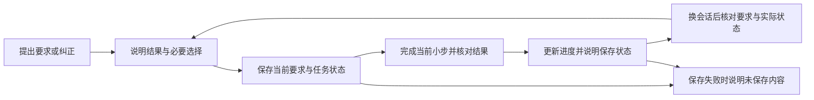

# VibeGuide 产品设计与功能优先级

初稿：2026-10-20；修订：2026-10-21。以下保留产品目标与设计依据。当前 `0.2.0-alpha.1` 已实现项目共识、验收记录、静态影响分析、Supabase 指南、个人偏好与按需记忆的可安装版本，范围见[六项功能说明](WORKBENCH.md)。模型行为与用户理解不能由接口测试代替。

用户本轮明确选择先开发六项功能，并排除代码撤回/文件恢复；下文历史 P0/P1 顺序不再作为本轮开发的前置门槛。原生对话、唯一 VibeGuide 模式与 DeepSeek Harness 首发方向保持。

## 1. 产品定义

**VibeGuide 是一个熟悉用户和项目的 AI 开发伙伴，帮助非技术创作者把业务想法变成可运行、可验证、能持续修改的应用。**

用户获得的价值是：表达一次后能继续做；遇到技术问题知道它与自己有什么关系；修改时保留原来的重要要求；完成后能判断实际效果；下次继续时不必重新交代全部背景。

**最高优先级的验收是用户理解选择：能用自己的话说明各选项的实际后果，以及为什么符合自己的目标。** 记录完整、回答简短、追问减少或主观安心，都不能替代这个结果。具体试用方法见第 9 节。

产品要持续帮助用户回答：

1. 我们正在做什么，怎样才算做对？
2. 我的项目目前怎样运转，这次会影响哪里？
3. 哪些事情需要我决定，下一步具体怎么做？
4. 已经验证了什么，还有什么没有解决？
5. 哪些理解和偏好会延续到下次，我怎样纠正它们？

默认交互仍是一段原生对话。说明、必要选择、预览和检查结果出现在发生问题的地方；用户可以随时说“解释一下”“你现在怎么理解我的项目”“继续上次的”“忘掉这个偏好”。这些是自然语言能力示例，不要求用户学习命令系统。

## 2. 谁先用，先做成哪件事

保留两个入口，进入同一条工作流程：

| 入口 | 已知条件 | 第一份有用成果 |
| --- | --- | --- |
| 我有一个想法 | 有业务目标，没有代码 | 一条可实际体验的使用流程，以及仍需决定或验证的条件 |
| 我已经做了一部分 | 有项目，但不清楚结构或修改后果 | 对当前任务相关部分的解释、保留要求和一项可验证改动 |

首轮验证聚焦个人或小团队的小型网页应用。新建验证样例先用 React、TypeScript、Vite；已有项目从已验证能读取与运行的同类项目开始。沟通能力可适用于其他项目，但不提前承诺所有技术栈的自动检查与恢复。

锚点任务：活动报名应用。P0 先使用已有、独立且可运行的样例，核对“打开页面 → 填写信息 → 保存 → 看见结果和名单”，再完成“限额 20 人”和“修改页面”两次改动，换会话续接并接受纠正。首轮不要求先建完整应用。最先确定本机演示还是真实多人报名；真实多人场景必须检查共享存储和名额一致性条件，不能默认降级成本地保存后声称满足要求。

这是一项选择范围的建议。现有证据主要是项目提出者的一手经历、案头研究和参考项目分析，尚不能说明哪类用户的付费意愿最高或这些痛点的总体发生率。

## 3. 从痛点到功能

**P0 只交付一个可单独试用的成果：用户说出要求，连续修改两次，换会话继续，AI 仍正确保留要求；用户纠正后，AI 能更新理解。** 每个关键选择都保持白话解释，并通过理解验收。以下能力按这个成果收缩，不作为六个同时开发的新模块。

| 功能 | P0 本次边界 | 后续范围 |
| --- | --- | --- |
| F1 需求对齐与项目共识 | 保存当前要求、必须保留的规则、用户纠正和来源；只澄清当前必要问题 | P1 完整业务流程、角色与项目词汇管理 |
| F2 项目理解与改动检查 | 续接时读取任务相关实际状态，发现要求与代码差异时按第 4.2 节处理 | P1 系统图、自动影响分析、跨模块结构检查 |
| F3 当场解释与操作引导 | 始终保留现有白话沟通规则，用项目中的后果与下一步解释；属于行为底线 | P1 专门的环境/API 引导流程与服务模板 |
| F4 小步交付与业务验收 | 保留必要业务检查；回复准确引用已有工具结果，说明检查时间、范围与当前未知项 | P1 结构化验收证据管理、自动关联与失效检测、更多回归覆盖 |
| F5 使用偏好与任务续接 | 同项目的要求、纠正和任务续接；当前明确沟通要求继续遵循 | P1 跨会话个人偏好管理与整合；P2 有条件的经验学习 |
| F6 保存进度与撤回改动 | 如实说明记录是否保存；记录续接不代表代码可撤销 | P1 有文件基线、影响预览和冲突处理的本地任务恢复 |

P0 新机制集中在项目/任务记录的可靠保存、读取和纠正。完整证据系统、自动架构检查、独立教学流程、长期个人画像均不作为首个试用成果的前置条件。收缩机制范围不降低理解、必要验证和事实准确的要求。

## 4. 核心体验：每次改动怎样发生

记录在关键决定或纠正发生时及时保存，不等任务全部完成才整理；中断与保存异常按第 4.5 节处理。

### 4.1 开始：帮助表达，逐渐形成架构

用户说“做一个活动报名页面”后，先弄清谁会用、要完成什么、数据由谁查看，以及真实使用还是演示。对于当前不影响结果的问题先保留；不把几十道开工问卷当成必经步骤。

用简单流程表达设计：“参加者填表 → 检查名额 → 保存报名 → 组织者看名单”。需要时再显示数据位置和相关模块。用户表达业务规则，Agent 负责选择并解释适当实现。

P0 的项目共识只保存当前要求、相关保留规则、纠正与来源，必要用语随任务说明。使用者、完整流程、数据位置与架构决定可逐步补齐；不要求先建立完整档案。计划与已观察的实现分开记录。

用户自有词语保留，但建立准确对应。例如把“点击后动一下”对应为当前按钮的点击反馈；不能记录成“React 等于动画”。同一个词有多个可能含义时，用项目中的具体例子澄清。

### 4.2 修改与续接：处理要求和实际状态的冲突

**用户的有效决定说明预期行为；代码和运行检查说明观察到的实际行为。** 文件更新、其他 Agent 的修改或测试通过，都不能单独证明用户改变了要求。AI 的推测不升级为已确认决定；仅阅读代码得到的行为推断也不能冒充运行结果。

| 遇到的情况 | 如何处理 |
| --- | --- |
| 用户明确改变目标 | 记录新决定、理由和被替代的旧要求；实现与验证状态另行更新，不能把新决定当成代码已完成 |
| 代码与既定要求冲突 | 并列保留预期、观察、来源与差异，说明影响；不得用代码现状覆盖用户要求 |
| 两条用户决定冲突，且没有明确替代关系 | 仅澄清影响当前行为的分歧；澄清前保留未解决状态，不自行选择“最新文件为准” |
| 存在其他人尚未协调的文件修改 | 保留改动，先核对差异；涉及同一范围的并发冲突时暂停依赖写入，继续不受影响的工作；不自动回滚或覆盖 |

例如原要求是“报名名单只有组织者能看”，另一个 Agent 改成公开访问：VibeGuide 应报告“原要求是仅组织者可见；当前检查发现未登录也可访问，存在名单公开的差异”。不得把“公开”记成新共识，也不能直接撤销对方改动。能在已有任务授权和无冲突范围内修复时继续处理；确需业务取舍或协调改动时才询问。无法确认实际访问状态时，明确写成代码分析发现的风险。

差异至少记录为“原要求及来源—当前观察及依据—影响—待处理事项”。只有新的明确决定才能改变预期；修复并核对后才能更新实际完成状态。未解决的差异保留到续接，不因重新生成摘要而消失。

用户提出实现办法时仍先理解目的。例如“满员后隐藏报名按钮”可能破坏原候补流程，需说明后果；改按钮颜色无须重新讨论报名业务。P0 仅围绕当前任务检查相关要求；跨模块重复规则、命名与架构边界分析留到 P1，结构整理单列任务。

### 4.3 卡住：把解释接到实际操作

解释采用适量的三层内容：当前项目中的含义、对使用结果的影响、现在可执行的动作。默认简短，用户追问时再增加细节；不强迫先学完一堂课。

例如遇到 API 权限错误：先确认实际使用的服务、账户和失败响应，再指出当前缺少哪个条件。能由宿主完成的检查直接执行；必须用户操作时，给准确页面/字段、应填信息的来源、预期结果，并在返回后做最小请求验证。不能只抛出“请配置环境变量”。

账户密钥交给宿主或服务的凭据机制，不写进项目记忆或教学例子。未取得页面或文档依据时，不编造按钮名称。一次请求成功只证明该请求接通，还需验证数据是否进入应用、失败时怎样表现。

P0 保留现有沟通能力与宿主能够执行的检查，不新增专门的引导系统。P1 根据实际试用中最常见的阻塞，选择一个服务打通可重复的完整流程。

### 4.4 完成：以用户行为和证据交代结果

每项需求都连接到可观察行为，例如“第 21 人提交时提示满员，并且没有新增有效报名”。先写清这种成功条件，再选择适当检查方式。

关键业务逻辑适合先建立可失败的检查，再修改实现；简单文案或视觉调整可用预览与针对性检查。垂直切片意味着打通一条使用流程，不是先做完全部页面、再集中补后端。测试驱动也不等于给所有样式修改增加测试负担。

完成回复按实际情况组织，不强制每次输出整张表：

- 发生了什么变化，怎样体验。
- 哪些新要求、受影响的旧要求已检查，依据是什么。
- 哪些仍未知、失败或需要用户体验确认。
- 下一步还缺什么，记录已更新到哪里。

“生成了代码”“本地可预览”“自动检查通过”“外部服务接通”“真实业务场景已验证”“公开发布”是不同事实。P0 直接引用已有工具结果并说明时间、范围和相关版本；P1 再建设自动关联与失效管理。测试通过不单独证明整体架构良好。

**历史检查结果与当前可用状态分别表达。** 历史记录可以是“昨天已成功接收一条留言”；当前状态可以是“今天尚未检查”。即使代码未变，服务停止、权限撤销、凭据失效或预览进程退出，也可能使当前功能不可用。

用户问“现在能不能用”、准备交付/演示或已发现相关条件变化时，检查与该问题直接相关的必要路径，例如预览是否可打开、当前权限是否有效。验证涉及新增外部写入或费用时按实际授权处理。已有足够新鲜且适用的结果时直接引用，不每轮重查整个项目。无当前依据则说明未知，给出具体检查办法；不能把“没发现变化”当成仍可用。

### 4.5 中断、任务切换与保存异常

任务执行状态与记录保存状态分开：任务可以进行中、暂停、已取消、完成或结果待核对；记录可以已保存、待保存或保存失败。代码修改成功与记录写入成功分别判断。只有持久写入得到确认后，才能说“已记住，下次可继续”。

| 情况 | 保存什么、保留什么 | 下次怎样接上 | 用户需要知道什么 |
| --- | --- | --- | --- |
| 正常推进或纠正要求 | 在关键决定、纠正与阶段结果出现时保存任务标识、当前要求、来源、进度和下一步；保留历史替代关系 | 读取最近成功保存的版本，并核对相关实际状态 | 影响理解的更新简短说明；无须每条记录再请求确认 |
| 做到一半关闭窗口或意外断开 | 只保证最近成功保存点；未完成工具结果标为未知，不假设关闭前一定能再保存 | 对照最后保存点、可访问的会话历史和相关文件/工具状态，核对是否已执行，避免重复操作 | 若存在进度缺口或仍运行的操作，续接时说明；历史不可取得时说明缺失范围 |
| 说“这个先不做了” | 将当前任务暂停，保存已做/未做事项；保留项目要求和已产生的改动 | 明确恢复该任务时才接上；不自动继续被暂停的动作 | 简短交代停在哪；若有无法立即停止的操作，如实说明状态 |
| 明确放弃任务 | 标记已取消，保留已发生结果；不自动删除项目共识或撤销代码 | 后续不把它当待办；重新开启时核对实际状态 | 取消任务与撤销已完成改动的区别 |
| 切换任务或同项目有两个未完成任务 | 每个任务分别保存目标、状态、下一步，共享有效项目要求；P0 只推进一个明确选定的任务 | “继续报名限制”可直接定位；“继续”无法唯一定位时，只问继续哪一项 | 有共享文件或要求冲突时说明；不合并两个任务的完成状态 |
| 代码修改成功，但记录保存失败 | 保留代码和最后成功记录，在当前会话展示未保存差异；不能把内存内容当成跨会话保存点 | 存储恢复后先核对最新记录和代码，再补录；不为补录重复执行已完成的代码/外部操作 | 当场说明“代码已改，记录未保存，不能保证下次自动接上”，附简短续接信息 |
| 保存结果未知或发现其他写入者更新了记录 | 不覆盖较新的记录；保留当前待保存内容，先核对实际存储版本 | 无冲突部分可合并；同一要求存在分歧时按第 4.2 节处理 | 若无法确认保存或影响当前任务，明确告知；不得宣称已持久保存 |

P0 必须验证持久写入成功、失败及未知结果的区别。异常可恢复时继续已有授权工作；异常会影响后续写入或正确理解时暂停相关步骤，不必让整个项目停摆。以上行为在原对话中呈现，不新增任务管理页面。

## 5. 怎样让用户感觉越用越好用

用户应直接感受到三件事：同一背景更少重复解释；同类任务更快进入正确步骤；已经纠正过的误解更少再次出现。单纯累积更多记忆条目不算成功。P0 先验证同项目要求和纠正的延续；下表中的长期个人偏好与条件性经验保留为后续方向。

| 记录类型 | 例子 | 使用范围与更新规则 |
| --- | --- | --- |
| 用户明确偏好 | “先说我需要做什么，再解释原因” | 经用户明确表达后可持续使用；用户可改、可忘记；项目级例外优先 |
| 项目共识 | “报名信息只有组织者可见” | 属于该项目；记录来源、决定和生效版本；不传播到其他项目 |
| 当前任务状态 | “限额已改，重复报名仍未检查” | 属于当前任务；结束后归档，续接时核对实际项目状态 |
| 条件性经验 | “此服务返回 401 时，先检查应用权限再重试” | 保存适用条件、依据和失效条件；一次成功不能升格为通用真理 |

明确表达的偏好与事实可以直接记录，并用一句话说明更新，无须每条再确认。AI 推测的偏好暂存为待验证理解；用户沉默、接受一次默认值、任务成功，都不能自动解释成长期偏好。

每条重要记录保留来源、作用域、更新时间及替代关系。用户可以在对话中查看“你记住了什么”，纠正和删除；不要求打开管理后台。明确表达在当前会话中立即应用，跨会话是否持久保存仍按第 4.5 节说明。

**忘记记录与修改功能分开处理。**

| 用户意图 | 记录如何变化 | 产品功能如何变化 |
| --- | --- | --- |
| 忘记沟通偏好 | 在请求范围内停止应用，更新删除/停用状态；保存失败时明确说明 | 不改代码或业务规则 |
| 明确只清除某项业务规则的记忆 | 停止将该条当作可用记忆；如独立规格或原始聊天仍保留它，说明边界；无其他有效依据时标为未确定 | 不自动取消功能，不自动删除独立项目规格 |
| 明确取消或改变业务功能，如“取消审核，以后同事直接发布” | 保存新要求及其对旧规则的替代关系 | 作为功能修改任务执行和验证；仅更新记录时不能说功能已改 |
| “忘掉之前那个审核要求”，上下文仍不能区分上述两种意图 | 保留未解决状态，只澄清“清除记录，还是取消网站审核” | 澄清前不改变产品行为 |

上下文已清楚时直接按意图处理，不对每次“忘记”机械追问。删除的记忆不得被旧摘要自动重新生成；后续涉及该业务且依据不足时应明确未知，不能从“忘记了要求”推导出“可以移除限制”。记忆删除、独立规格修改、原始聊天删除与代码变更的结果分别说明。

上下文按当前任务选择：持续规则保持简短，相关项目事实与必要证据按需读取，过期信息退出当前上下文，原始依据仍可追溯。目标是少量、相关、足够的信息；不能为缩短上下文丢掉关键业务约束。

开源记忆实现研究移至文末附录，作为后续机制参考，不构成 P0 功能要求。

## 6. P0 最小内部机制

保留一个开发 Agent 和现有白话规则。新机制只服务要求的可靠续接；当前宿主接口须先实际核实。

| 组件 | P0 职责与边界 |
| --- | --- |
| 项目/任务记录 | 当前有效要求、纠正及来源、任务标识、最近保存点、进度、下一步和未解决差异；预期与观察分开 |
| 读取与保存 | 在关键变化时持久写入并确认结果；续接读取最近成功记录，检查外部改动；失败或并发冲突按第 4.5 节处理 |
| 当前相关上下文 | 只带入本任务需要的要求和来源，必要时读取代码；不建设完整项目图或长期画像 |
| 结果说明 | 引用已有工具结果，说明时间、范围、历史与当前状态；P0 不建设完整证据库或自动失效引擎 |

使用可审阅的本地记录即可起步；路径、稳定身份和版本检查方式在宿主验证后确定。文件存在、摘要生成或结构校验通过，都不能替代保存结果与语义正确性的检查。检测到实际状态与预期冲突时必须走第 4.2 节流程，不能以刷新摘要的名义覆盖要求。

## 7. 优先顺序与发布范围

### P0：先交付一次可理解、可纠正的续接体验

1. 冻结一个短任务、两次改动及关键选择的预期后果；先观察当前白话沟通是否让用户理解。
2. 核实宿主身份、持久保存与恢复能力；完成当前要求、纠正和任务进度的最小记录。
3. 在同一项目执行“两次修改 → 换会话 → 继续 → 用户纠正”，验证要求保留和理解更新。
4. 用同一套记录覆盖冲突、中断、任务切换和保存失败；引用已有工具结果如实说明状态。
5. 用用户对选择后果和理由的复述决定是否值得继续扩展。理解不通过时先修正解释与选择设计。

P0 不等待完整架构分析、外部服务流程、结构化证据系统或长期个人偏好整合完成。现有白话沟通始终保留，必要业务检查照常执行。试用成果和异常情况的具体退出条件见[实施计划](DELIVERY_PLAN.md)。

### P1：降低真实使用与反复修改的成本

按试用暴露的最大阻塞排序，不承诺同批全部开发：

- 验收证据管理：再实现需求与检查自动关联、版本和外部条件变化后的失效标记，保留历史记录。

- 本地任务保存与恢复：用户可说“撤回刚才这次修改”，先显示影响范围，保留其他工作；覆盖未跟踪文件与已有脏改动，处理恢复冲突。外部数据、已发送消息和部署另行处理，不能承诺全部 Command+Z。
- 外部服务完整引导：优先一个真实高频集成，跑通配置、最小请求、业务使用、错误反馈与恢复，随后复用模式。
- 项目结构增强：逐步建立系统图、命名与模块边界检查、相关回归检查；避免为了好看而生成巨型架构图。
- 个人偏好管理：再实现跨会话偏好读取、整合、纠正与删除；有反馈后才评估推断，允许项目例外，检查误记和错误迁移。

### P2：在有证据后扩展

跨宿主、跨项目知识迁移、复杂团队协作、自动生成并评估技能、更多服务连接与长期经验优化。业务约束与用户决定始终独立保存，不能交给自动优化过程随意改写。

暂不投入独立聊天前端、默认翻译侧栏、完整编程课程、无限连接器目录、每轮多 Agent 重跑、没有依据的质量总分。它们尚未被证明是当前闭环的主要缺口。

## 8. 参考项目怎样转化成设计

| 参考 | 已观察的思路 | VibeGuide 的采用方式 | 不直接推导的结论 |
| --- | --- | --- | --- |
| 小盖《AI Coding 很容易踩的一些坑。》16 张图 | 反向澄清、共享术语、垂直切片、测试驱动、模块边界 | 少量关键澄清；项目词语与规则；完整小流程；以行为验收；修改时检查边界 | 大量问卷必然更好；产出提高十倍；非技术用户应先学会整套工程术语 |
| Techie 固定版本 | 面向非技术用户的解释、学习、记忆、历史与恢复工作流 | 原生对话中的解释、续接、进度保存与可理解恢复 | 有一个技能名称就代表恢复完整可靠或能记住一切 |
| Harness² 固定版本 | 比较候选 harness 的行为，把有依据的经验用于后续改进 | 内部评测先使用候选规则对比，允许保留原版；后续才考虑条件性经验学习 | 无需验证就会自动更懂个人；研究框架可直接替代产品；每轮重跑必然值得 |
| Anthropic 上下文工程说明 | 高信号信息、按需检索、压缩和结构化记录 | 选择当前相关内容，同时保留可追溯依据和关键决定 | 上下文无条件越短越好 |

Harness² 对我们的直接价值首先在开发过程：从真实失败案例提出规则改动，用隔离任务比较，再决定采用或保留原版。这个轻量方法可从 P0 开始，不需要先接入完整框架。用户侧的长期自动学习属于后续功能，不能和内部规则迭代混称为“已实现自进化”。

来源：

- [小红书原文](https://www.xiaohongshu.com/discovery/item/6a06fd92000000003601852a)，本次讨论此前已逐张阅读 16 张图片；作者观点与产品效果证据分开。
- [Techie README，固定提交 ffb92c7](https://github.com/dhpwd/techie/blob/ffb92c7b6b58e69d9dec0fca9cd462020ea48110/README.md)。
- [Harness² README，固定提交 1cfe254](https://github.com/google-research/harness2/blob/1cfe254e8d25b15f37048c3730134686abe60335/README.md)及[论文](https://arxiv.org/abs/2610.14224)。其本地确定性演示只证明流程可运行；不证明 VibeGuide 或真实模型质量提升。
- [Effective context engineering for AI agents](https://www.anthropic.com/engineering/effective-context-engineering-for-ai-agents)。

## 9. 怎么判断产品真的变好

**理解验收是最高优先级的产品门槛。** 在试用中抽取一个确有业务后果的选择，在不提供标准答案、不先替用户解释的情况下，请用户用自己的话说出：两个选项各会带来什么结果，为什么选择其中一个，以及这会让自己的项目发生什么变化。

评测前写清必要后果，例如“同事直接发布”与“组织者审核后发布”分别何时对外可见、谁承担发布责任。评审核对用户表达是否覆盖这些关键点，理由是否与其目标一致；不要求复述术语或选择 AI 推荐项。用户合理地改变目标可以通过，误解实际后果不能通过。

| 观察结果 | 如何判定 |
| --- | --- |
| 能说明两个选项的关键后果、自己的理由，且与实际含义相符 | 该次理解通过；仍需分别检查功能正确性 |
| 说明太长而跳过、随便选，或只说“听你的”却说不出后果 | 该次理解不通过，优先改解释和选择呈现；不能把少追问记成收益 |
| 表示很放心，但把公开、审核、费用等后果理解错 | 该次理解不通过；主观信心单独记录，不能抵消错误 |
| 经额外解释后才理解 | 分别记录首次未通过与补充后通过，以及额外阅读和追问负担 |
| 用户未接受观察、没有获得复述或无法判断 | 记为未测/不确定，不推定通过，也不把它固化为用户能力标签 |

这是抽样试用方法，不是日常每次选项都要求用户复述的产品步骤。自动评审只能发现候选问题，不能替代真实用户理解证据。

在理解门槛之外，P0 观察：

| 检验点 | 观察方法 | 不合格情况 |
| --- | --- | --- |
| 要求保留与纠正 | 两次修改、换会话续接、再纠正一条要求 | 遗忘未取消的要求，纠正未替代旧理解，或理解不清仍擅自推进 |
| 要求与代码冲突 | 用独立改动制造可访问范围差异 | 将代码变更写成新决定，或覆盖未经协调的其他改动 |
| 忘记与功能修改 | 分别表达删除记忆、取消功能和有歧义的“忘掉要求” | 删除记录被当作功能已修改；上下文明确仍反复确认 |
| 中断与保存异常 | 按第 4.5 节状态表执行关闭、暂停、切换、失败与未知结果 | 错接任务、重复已执行操作、取消后擅自继续、未保存却称已记住 |
| 历史与当前状态 | 代码不变但关闭预览或使依赖不可用 | 把过去检查成功当作现在可用，或每轮无差别重查整个项目 |
| 成本与负担 | 记录重复解释、额外确认、返工、总 token 与耗时 | 只因回答短、记忆多或 token 少就判定有效 |

使用[评审细则](../evals/RUBRIC.md)和[手动对照流程](../evals/MANUAL_COMPARISON.md)。各组从同一原始需求和独立相同初始项目开始，不复制另一组产物。先取得小范围试用结果，再扩展严格对照；完整三组实验不是首次可试用成果的前置工程。

现有手动工具只准备标准模式与 VibeGuide 两组，简单白话组需另行准备。静态场景不证明跨会话和保存可靠性；真实用户未参与时不得宣称理解门槛通过。小样本只决定迭代方向，理解或事实准确不通过时先修正，不靠增加功能抵消。

## 10. 本轮交付边界

本轮优先修订冲突处理、忘记与功能变更边界、异常状态、理解验收，并收紧 P0；同步实施计划与评审文字标准。未修改插件行为、安装配置或评测执行代码，也未开始实际开发验证。接口可靠性、模型行为与用户理解分别通过后续宿主验证、实际任务和用户观察判断。

## 附录：ChatGPT 体验与 OpenAI 开源记忆参考（2026-10-21）

本次核对未找到官方发布的 ChatGPT 生产记忆系统完整源码。官方帮助文档介绍了相关上下文的使用、记忆摘要、来源查看和纠正等产品行为；这些说明不能用于断言其内部数据库、检索算法或抽取提示词。ChatGPT 的云端记忆与 Codex 的本地记忆也不能视为同一实现。

可以直接研究的代码是 OpenAI 的 Codex 记忆模块。本次固定提交为 `d571eaf1f61d0d93a797506335a99a9950ffe37b`，已读取记忆 README、两阶段执行源码、V2 抽取与整合提示模板、V2 读取模板及 Apache-2.0 许可证。源码含不同记忆版本路径；V2 模板可作为设计参考，不据此宣称所有客户端均默认启用 V2。本次未运行这些模块或验证其效果。

值得采用的规则：

| 参考机制 | VibeGuide 的具体设计建议 |
| --- | --- |
| 从单次任务提取记录，再跨任务整合 | 明确偏好在当前对话立即生效；后台在任务稳定后整理记录，避免每轮重新总结全部历史 |
| 一次性要求与可复用偏好分开 | “这次先给我看方案”只属于本任务；“以后改动前先给我看方案”才进入长期偏好；应用时仍保留例外和作用域 |
| 用户表达与 AI 推测分开 | 明确偏好可以自然形成记录，无须必须说“请记住”；推断先作为候选，不能因沉默自动升级 |
| 后续纠正优先，保留来源 | 用户改变习惯或已经掌握某个概念后更新旧理解；避免永久贴上“什么都不懂”的标签 |
| 简短摘要与按需读取 | 默认带入当前相关的少量偏好和项目记录，需要依据时再读取详细来源；不整段重放历史 |
| 可查看、纠正、停用和忘记 | 在原对话支持“你为什么这么回答”“这次不要用以前的偏好”“忘掉这个习惯”；明确临时停用与删除的差别 |
| 删除后的内容不得被旧摘要重新写回 | 记录更正和删除状态，整合时处理关联摘要；仍保留的原始聊天须说明，不把停止使用说成所有副本已删除 |

建议的最小流程：对话中的明确偏好或纠正 → 带来源和作用域的候选 → 更新或替代相应记录 → 当前相关内容进入回答 → 用户可纠正或忘记。每条最少保留内容、类型、作用域、来源、更新时间及生效/被替代/停用状态。

本节保留后续实现参考，不扩大 P0。P0 只落实当前项目要求、纠正、记录删除边界与续接；跨会话个人偏好整合、后台自动沉淀和行为推断后置。业务规则独立保存，不能仅寄希望于记忆检索命中。

对应能力实施时的验收案例：一次性要求不会污染下次任务；当前明确要求可覆盖旧偏好；项目用语不传播到别的项目；纠正后不再采用被替代内容；忘记后后台整合不会把旧偏好重新生成；检索无关记忆时不影响回答。

来源与边界：

- [ChatGPT 官方记忆说明](https://help.openai.com/en/articles/8590148-memory-in-chatgpt)：产品行为和可用控制，具体体验随账户等条件变化；不是实现源码。
- [ChatGPT 与 Codex 记忆的区别](https://learn.chatgpt.com/docs/customization/memories)。
- [Codex 记忆流程说明，固定提交](https://github.com/openai/codex/blob/d571eaf1f61d0d93a797506335a99a9950ffe37b/codex-rs/memories/README.md)、[V2 单任务提取规则](https://github.com/openai/codex/blob/d571eaf1f61d0d93a797506335a99a9950ffe37b/codex-rs/memories/write/templates/memories/stage_one_system_v2.md)、[V2 长期整合规则](https://github.com/openai/codex/blob/d571eaf1f61d0d93a797506335a99a9950ffe37b/codex-rs/memories/write/templates/memories/consolidation_v2.md)：可读代码与提示模板，不代表 ChatGPT 内部采用同一架构。
- [OpenAI Agents SDK 跨运行记忆指南](https://developers.openai.com/api/docs/guides/agents/sandboxes#persist-memory-across-runs)：另一份实现参考，区分会话历史、记忆和工作区恢复；不要求 VibeGuide 更换宿主或模型供应商。
