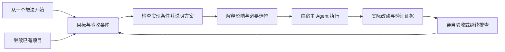
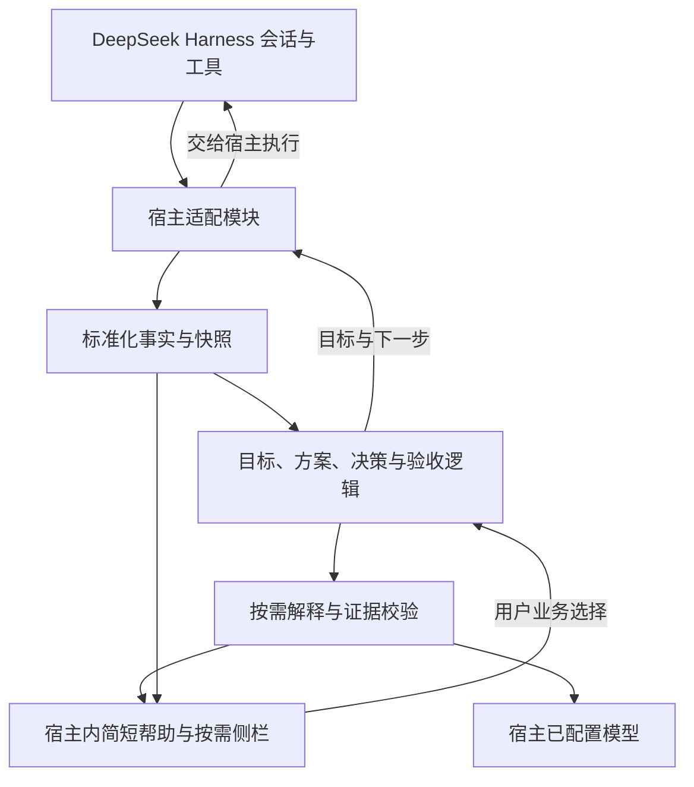

# VibeGuide 产品与架构设计

> 2026-10-14 方向修订：用户希望 AI 的回答本身让非技术人员看懂。最新设计见 [原生对话设计](CONVERSATION_FIRST_DESIGN.md)。下文关于“技术原题 + 旁边解释／侧栏”的主交互已被替代；既有用户目标、证据和意图保留要求继续适用。

日期：2026-10-14。状态：DRAFT。基于 office-hours 工作流整理；用户已明确选择集成在 DeepSeek Harness 内。当前交付为 HTML 概念原型，未实现或安装真实插件，接口兼容性尚未运行验证。

## 1. 产品定位

愿景：**Make technical systems legible to non-technical people.**

产品定义：VibeGuide 是嵌入 DeepSeek Harness Web 的理解与引导层。开工前说明新功能的实现条件和预期使用效果；在 AI 提问、要求确认方案时，把技术选择转成用户可以判断的使用后果，再把真实需求准确传回 AI；随后用具体改动和验收证据检查实现是否符合目标。

面向用户的表达：**看懂你在做什么，知道下一步为什么这样做，确认它真的有效。**

一次成功使用必须让用户回答五个问题：

1. 我的应用现在能做什么，数据在哪里？
2. 这次 AI 想改变什么，会影响谁？
3. 哪些选择需要我决定，选完有什么后果？
4. 我凭什么相信已经完成，哪些还没有验证？
5. 新功能有哪些实现条件，当前已经确认什么、还需要验证什么？

不把聊天记录长度、解释数量、代码行数当作产品价值。主要衡量用户是否能做出符合自己目标的选择，并完成验证。

用户的直接反馈包含：技术性提问看不懂、需要另问含义与影响、不知道新功能能不能做、看不懂 plan 和技术栈，开工后感觉项目不在掌控之中。因此 P0 是**可行性与白话方案—理解关键选择—对照目标验收**的最小闭环。不能只做术语词典，也不应借此增加大量审批。

本轮补充了4项实证研究、5条公开经历与5份宿主问题报告，逐项记录身份、工具和局限。它们支持表达与验证困难等机制，不能证明本方案或某种布局已有效。详见[用户痛点调研](USER_RESEARCH.md)。完整系统地图降为P1增强；与当前决定有关的数据位置和影响仍在P0说明。

## 2. 用户与共同任务

用户明确希望同时覆盖前两类人，采用两个入口和同一个工作循环。

| 用户 | 进入时的状态 | 第一份价值 | 主要障碍 |
|---|---|---|---|
| 从零开始的新手 | 有业务想法，没有项目 | 把想法整理为可观察的结果，并带着做出本地原型 | 不会拆需求，不知道哪些问题必须先想清楚 |
| 已在用 AI 编程的创作者 | 有代码或原型，难以判断 AI 的工作 | 把现有项目和当前改动映射到用户行为 | 不理解依赖、状态和改动后果，不会验收 |

共同任务是“完成一个自己理解并能验收的改动”。新建应用也是第一个改动。第一版把任务范围限定在小型网页应用：表单、列表、简单规则、本地数据保存。技术支持范围先选 React + TypeScript + Vite；已有项目超出范围仍可显示工具事实和文件改动，但不宣称能生成完整业务地图。

具体锚点：活动报名原型。新手从“我要收集活动报名”开始；已有项目用户从“限制最多 20 人报名”开始。二者最终使用相同的目标、方案、决策和验收记录。提问与方案解释可处理其他技术文本，但不等于对其他技术栈具备完整项目检查能力；图片识别等案例只用于解释与可行性评审，不扩展本地网页执行MVP范围。

已有用户明确自述“技术提问难懂导致盲选”的痛点；尚未通过观察实验测量频率与方案效果。当前三条假设是：将技术问题转成使用场景能降低需求误配；结合已有目标比临时要求 AI 换种说法更有效；宿主安装与提问接入的门槛可以被接受。后文的对照实验用于证伪这些假设。

## 3. 已选形态与后续路线

| 路线 | 核心形态 | 工作量与风险 | 优点 | 代价 |
|---|---|---|---|---|
| A 最轻验证 | 一个 skill 输出目标、决策和验收模板 | 小；低接入风险 | 很快验证文案和提问质量，可跨工具试用 | 缺少可靠事件归属、持续视图和证据失效处理 |
| B 已选首发形态 | DeepSeek Harness Web 插件，内部隔离业务逻辑与宿主接口 | 中；宿主兼容风险中高 | 可观察真实事件并展示侧栏；Web交互对两类用户的适合程度待试用 | 开发预览接口在变；客户端打包必须先做技术验证 |
| C 长期形态 | 独立理解核心，分别接 DeepSeek Harness 与 Claude Mods | 大；维护风险高 | 同一用户工作模型可跨宿主延续 | 双套 UI 和生命周期会拖慢第一轮学习 |

用户已选择 B：VibeGuide 集成在 DeepSeek Harness 内。本轮只修订呈现这一集成形态的 HTML 概念原型；A 可辅助验证文案与真实任务，C 留到首个宿主证明价值后。宿主选择已定，安装成本与两类用户的实际理解效果仍须观察，不能只因有图形界面就认定可用。

技术依据：DeepSeek Harness 已有侧栏扩展、持久会话事件和工具结果接口；Claude Mods 可添加面板及处理工具调用，但面板显示受运行界面限制。[宿主研究与来源](RESEARCH.md)

首发实现的硬条件是：能否可靠取得正在等待的用户问题，并把答案交回同一个问题。普通 followup、观察工具事件和绘制侧栏都不能替代这一能力验证。用户提到的 Codex 属于后续适配候选，本轮没有核实其提问 UI 的扩展接口，不承诺可原生接管。

## 4. 核心体验



### 新手入口

入口文案：“你想让谁完成什么事情？”示例：“我想让朋友填写活动报名信息，并看到报名名单。”

逐步澄清会改变实现结果的少量问题：谁使用；要完成什么动作；怎样算成功。对简单原型给出可调整默认值，一次只问一个关键问题，不让用户先选框架或数据库。

先展示计划中的使用流程：“填写报名 → 检查名额 → 保存 → 显示结果”，说明本次包含/不含、保存位置和关键未知项。流程标记“计划”，不能被误读成已经实现；不要求先生成完整系统地图。

初次启动还需要识别宿主是否已运行、模型是否配置、是否选定项目目录。缺项时逐项引导进入宿主配置；不收集第二套密钥，不暗示本地插件必然离线或免费。未准备好前保留目标草稿，不重复要求用户描述需求。

首个原型明确注明“当前仅用于本机演示”。示例可以使用浏览器本地保存，但应解释：换浏览器或清除站点数据后可能看不到记录，多人之间不会共享名单。需要公开链接、真实参与者和共享数据时，生成下一阶段方案，而不把本地演示标记为可上线应用。

### 已有项目入口

选择当前项目后，先读允许范围内、与当前目标有关的项目清单及文件。优先说明这次功能的已有条件、计划影响和检查范围，例如“已找到报名页；保存位置待核实”。不能读完全仓库才允许提问。

后续P1系统地图按需给出3–7个与任务相关的节点，点开才查看文件依据。节点间“已找到调用关系”和“模型推测的数据流”必须可区分；它不是P0开工的前置条件。

### 共用工作循环

**开工前：先知道会做成什么、还有什么没确定。** 将方案转成实际使用流程、包含与不含、关键前提、下一份可展示成果。区分一般技术可行与当前项目已验证；关键条件未知时，由宿主在既有授权范围内检查或做有限验证。结果只能证明所测范围，不能把依赖缺失当成永远做不到，也不能把一次接口成功当成整项功能可靠。

**AI提出选择时：让用户按实际需求回答。** 用户可点击“看懂这一步”，或在引导模式与宿主支持时直接看到同一问题附带的简短说明。先读本次目标、原问题、原选项和必要上下文，明确 AI 究竟在请用户决定什么。

提问辅助执行六步：

1. 判断问题属于产品需求、实现细节还是操作授权。涉及使用方式、数据可见性、持续成本或后期维护的取舍，由用户决定；一般技术实现可在已有约束内由 Agent 提出默认方案；权限请求继续走宿主原生授权。
2. 把每个选项写成具体场景：“选完后，谁能做什么，哪些事情做不了？”有依据才说明费用和维护差异，不从技术名称直接推导产品能力。
3. 结合用户已经说过的需求解释推荐理由；若某选项冲突，指出冲突。需求不足时只追问会改变选择的一项，不为了给推荐而猜测。
4. 提供“我想要的效果是……”和“这些都不符合”入口。原选项可能不完整，允许回给 Agent 一组需求约束并请求新方案。
5. 用一句可编辑的话展示将回传的意思；用户可直接确认并发送。用户的自然语言选择与 Agent 的具体技术方案之间允许一对多映射，不强行伪造成原选项之一。
6. 将结果绑定原问题与当前版本交回宿主，并记录需求约束。随后用验收条件检查实现是否遵守这些约束。

不要把每道问题都变成两次确认：普通选择可用“选择并发送”一步完成，按钮旁显示将发送的含义；只有补充约束或方案仍有歧义时才需要继续澄清。用户不必通过理解考试，也不会因选择“我不知道”而无法继续。

例如 Agent 问：“先用 localStorage 做本地原型，还是增加服务端存储支持共享报名？”VibeGuide 的解释可以是：

| 用户看到的选择 | 实际后果 | 需要核对 |
|---|---|---|
| 先在我这台设备上试用 | 名单保存在这个浏览器中，其他人的浏览器不会自动共享 | 是否仅做演示；清除浏览器数据的影响 |
| 让大家报名后汇总到同一份名单 | 需要设计共享存储与相应服务 | 谁能看名单、是否需登录、部署与运行费用尚待方案确认 |

若用户回答“朋友用各自手机报名，我能看到全部名单，但他们不能看到别人的信息”，回传的是这三个需求约束及“请提出满足它们的方案”。不能仅回传“选 B”并擅自补上公开名单或特定数据库。当前本地原型范围若无法满足，应明确请求扩展方案，不能将用户降格为接受单机演示。

技术选型不能被机械翻译：SQLite 不必然代表只能单人使用，云数据库也不自动解决权限和多人一致性。保存位置、共享方式和可见权限需要分开说明。原始问题与技术详情始终可展开。

AI 请求确认整个方案时，先呈现“最终能完成的事情、不会包含的事情、一次实际使用流程、需要用户承担的维护与费用、与已述需求的冲突”，再允许确认或修改。结构化提问可走宿主问答协议；普通聊天里写出的提问和方案，首版通过用户选中或粘贴内容启动辅助，不能假设存在可自动接管的等待状态。

用户提出“最多 20 人报名”后，VibeGuide 先整理目标、已有规则与验收条件。对会改变业务行为的分叉提问，例如“满额后关闭报名，还是登记候补？”对排版和重命名等一般实现细节，不增加产品级审批。

用户决定形成一个有编号的决策，连同验收条件交给宿主 Agent。执行过程按业务阶段展示，详细工具日志可展开。结束时，对比本次目标、实际文件变化和测试结果，输出验收卡。没有发生变化、工具失败和测试未运行都要明确展示。

向宿主提交任务是必须单独验证的适配能力：阶段 0 要验证用户选择能经受支持接口发送，且执行可关联到对应 Task。若只能由用户手动发送，界面明确显示“待发送”，提供可复制任务文本；发送后若无法可靠关联，就保留为未关联记录，不能假装已自动执行。

## 5. 页面结构与示例

概念原型保留 DeepSeek Harness 的三栏结构：左侧为工作区与会话导航，中间为原对话、会话顶部操作及 composer 内的原生问题，右侧为按需打开的「VibeGuide」tab。宿主聊天仍是主要输入区；VibeGuide 解释当前问题和方案，不另设主聊天或项目导航。右栏以 `sidebarRightTabs` 和 `sidebar.right.pane.tab` 为拟接入点，窄屏呈现遵循宿主右栏的全屏／收起机制。[固定提交的原生布局与扩展依据](RESEARCH.md#原生布局与概念原型边界)

原消息旁的短说明或“看懂这一步”入口，以及右栏选择与原题草稿、提交和取消状态的同步，仍需技术验证。已声明的消息／工具 slot 有所有权、基数和作用域限制，不承诺任意位置注入；不能接原位入口时使用右栏入口。关闭解释后返回原题并保留草稿是目标行为，当前 HTML 仅模拟这种联动，不代表真实插件已接入。

新手可开启“自动解释关键步骤”，熟悉用户可选“需要时再解释”。前者在计划和关键选择时显示短说明，不在每次工具调用时弹窗。两种方式共享目标、问题、答案和验收。四种交互形态比较、可行性样例与五个评审案例见[交互设计](INTERACTION_DESIGN.md)。

首版面板聚焦“当前目标、这次方案、需要决定什么、结果与验收”，以同一任务组织，详细记录折叠。存在待回答问题时优先显示白话问题、使用后果、与已有目标的关系、将回传的含义。以下仅是右侧 VibeGuide tab 的内容示意，外层仍为 Harness 界面。完整系统地图留到P1，不设为必经页面。

```text
VibeGuide                         活动报名原型 · 本地演示

当前目标：最多接收 20 个正式报名
下一步：决定满额后的处理方式

报名页面 → 名额检查 → 浏览器保存 → 提交结果
               ↑ 这次主要影响这里

需要你决定
满额后，后来的人还能留下联系方式吗？

关闭报名（建议用于这次简单活动）
  第 21 人看到“名额已满”，不再保存这次提交。
登记候补
  后续提交保存为候补；自动补位不包含在本次改动中。

[选择关闭报名] [选择候补] [我需要了解更多]

依据与细节：当前规则 / 相关文件 / 尚未检查的部分
```

推荐必须绑定用户目标；需要候补的活动不能默认关闭。选择只确认业务意图。执行命令、联网、安装或发布仍遵守宿主权限，不能把业务按钮当成通用授权。

改动完成后的示例卡属于预期设计，以下结果在真实产品中必须由证据填充：

```text
已改变：满 20 人时，页面显示“名额已满”。
已观察：2 个文件已修改；名额规则测试通过。
仍未验证：两位用户同时抢最后一个名额时的表现。
环境：本地原型，尚未发布。

请亲自检查
1. 用测试数据填到第 20 位，确认仍可提交。
2. 再提交一位，确认显示“名额已满”且没有新增记录。
3. 刷新页面，检查这台浏览器中的记录是否保留。

[打开本地预览] [记录我的验收结果] [查看证据]
```

观察与解释分开：例如“请求返回 403”属于事实；“可能是权限不足”属于推测；“数据是否保存”可能仍未知。没有观察到存储内容，就不能说“没有写入”；没有备份证据，就不能说“已有备份”。

系统状态使用文字加图标，不仅靠颜色。代码默认折叠而非不可见。提供“详细一点”“更简短”“这个解释不对”入口，允许用户调整术语与粒度。避免儿童化隐喻；把 API 解释为应用请求另一项服务的接口，并关联当前动作。

## 6. 首版范围

### P0：最小闭环必须完成

- P0 提问辅助：取得或由用户粘贴原问题，结合目标解释选项、支持自由表达、展示回传内容，保留原问题与决定的关联。自动接入与手动辅助明确区分。
- 可行性与白话方案：说明预期使用流程、包含/不含、关键条件与未知项；必要时先提出可检验的下一步，不给无依据的可行承诺。
- 两个入口：新建一个受支持原型，或打开一个受支持的已有项目。
- 目标卡：记录用户意图、边界和可观察验收条件。
- 与当前任务有关的保存位置、使用边界与文件依据；无需完整系统地图即可工作。
- 决策卡：将必要的业务选择传给宿主，保留选择记录。
- 改动卡：区分拟执行、已成功执行、失败、没有变化和来源未知的变化。
- 验收卡：技术检查与手工验收分别记录，标明代码版本和未测场景。
- 刷新和重连后恢复当前任务；切换会话不串数据；解释失败仍可查看基础事实。

### P1：P0完成用户验证后增强

简化系统地图、详细决定/改动时间线、结构化“哪里不对”诊断、恢复选项说明。P0仍须显示基础错误事实、保留决定记录和允许自由文本反馈；P1增加便于浏览与排查的工具，不将基本可靠性推迟。

### 明确留到后续

跨宿主同步、多人实时协作、任意语言自动建图、全仓库精确调用图、云托管、自动生产发布、付费交易与支付教学、通用数据库迁移、通用自动回滚、事故自动修复。MVP 不提供“一键安全上线”或“一键恢复所有状态”。

错误发生时提供下一条可核验行动，必要时导出脱敏诊断摘要；涉及新写操作时仍由宿主执行并记录。用户“我验收过了”只形成用户报告，不能自动变成测试通过或生产就绪。

## 7. 架构

VibeGuide 自己负责目标、解释、决策记录和证据关联。代码生成、工具执行、权限、模型凭据及应用运行交给现有宿主。第一版只做一个插件包，内部设清晰模块；不提前创建多包平台。



技术选择建议：TypeScript 的纯数据核心、宿主原生客户端组件、JSON Schema 或同等运行时校验、基于录制事件的集成测试。客户端构建遵守 DeepSeek 的扩展格式，框架及构建细节在技术验证后锁定。第二个宿主出现前不抽象通用 UI 框架。

### 事实对象

以下名称是 VibeGuide 的拟定数据契约，不是任何宿主已有 API：

| 对象 | 最小字段与职责 |
|---|---|
| Task | taskId、projectId、sessionId、用户原话、目标版本、范围、约束、验收条件、状态 |
| PlanReview | planId、taskId、原方案引用与版本、预期使用流程、包含/不含、实现前提、未知项、拟验证步骤、evidenceIds；确认方案不代表验证通过 |
| SystemNode | nodeId、用户可理解名称、角色、文件证据、计划/已发现/推测状态 |
| ChangeSet | changeId、taskId、工具调用 ID、前后快照、文件变化、执行结果、归属状态 |
| Claim | claimId、文字、observed/inferred/unknown、evidenceIds、适用快照 |
| HostQuestion | questionId、宿主原始关联 ID、sessionId、问题版本、原文、选项原始 key/label、种类、pending/answered/cancelled/expired；手动粘贴时原始 ID 可缺失 |
| Decision | decisionId、questionId、taskId、目标版本、planId/方案版本（适用时）、解释版本、选项与后果、用户原话、需求约束、可编辑回传内容、发送状态、选择时间；不充当权限凭证 |
| Evidence | evidenceId、类型、来源引用、工具/测试结果、采集时间、代码及环境指纹 |
| Verification | checkId、验收条件、not_run/passed/failed/blocked/stale、证据、用户报告 |

每个标准化事件带 schemaVersion、host、projectId、sessionId、eventId、源序号及时间；能取得时附 turnId、agentId、toolCallId。不能可靠关联的事件保留为“未归属”，不能凭时间相邻就说它属于本次任务。项目标识包含解析后的目录和工作树身份；多个会话修改同一目录时，文件来源可能仍不确定。

### 最短数据路径

1. 接入持久会话事件和最终工具结果，保留稳定来源 ID。
2. 从确认成功的文件工具结果采集实际 diff；调用参数只用于“计划做什么”。
3. 用文件内容哈希标记快照。额外文件变化需重新读取并标记来源，不能擅自归因于 Agent。
4. 普通工具活动只更新事实；收到受支持的待回答问题、用户主动请求或任务结束时请求相应解释。提问解释独立于事后汇总，必须在选择前出现。
5. 解释模型只能引用提供的 evidenceIds。程序校验引用存在、未过期、属于同一项目；未经证据支持的内容标为推测或未知。
6. 测试证据关联具体代码快照、测试命令和环境。项目相关文件变化后使结果过期；MVP 可保守地使该项目全部验收失效，避免假精确。
7. 渲染卡片。模型调用超时、输出不合法或额度不足时，保留文件、操作结果和“解释暂不可用”，不阻断宿主开发。

文件证据存在不代表文字解释正确。运行时校验能排除假引用，不能证明业务语义，仍需固定案例人工评审和用户验收。关于“为什么这样设计”的理由只能引用用户选择或明确记录的需求；从代码推断的理由必须标为推测。证据用于辅助开发判断，不宣称防篡改审计或观察到所有外部操作。

### 持久化与成本

复用宿主会话事件作原始记录。插件持久化 Task、PlanReview、HostQuestion、Decision、Verification、用户验收报告、适用快照、证据索引及解释缓存到宿主提供的插件存储；若技术验证发现不可用，则用插件专属本地 JSON/JSONL 存储并采用单写者和原子快照替换。刷新后保留验收报告，相关代码变化后把报告标为针对旧版本。避免第一版引入独立数据库服务。

缓存键至少包含项目、快照、任务、目标版本、适用方案版本、模型和提示版本；提问解释额外包含问题与选项版本。每个任务默认自动汇总一次，同一问题/目标/方案版本组合至多自动生成一次解释；重放事件不重复计费。目标或方案变动使旧推荐失效；重新生成不能抹掉用户草稿。超长任务可主动刷新。解释请求设输入上限、超时与可取消状态，记录可获取用量；费用未知不能显示0。模型来源和费用归属在技术验证中确认。

## 8. 信任与能力边界

VibeGuide 最重要的质量风险是让用户产生没有证据的确定感，或将用户意图翻译错。默认观察开发事件并辅助回答；只有用户选择的回答通过已验证接口回传，不声称拦截宿主内一切提问或操作。

- 原问题、原选项和限制完整保留；不隐去重要代价，不把原本缺失的方案伪造成 Agent 已提供的方案。推荐理由必须可对应已有目标。
- 发送前检查问题仍待回答、问题/目标/适用方案版本未变、会话匹配。问题取消、宿主已答或任一关联版本更新时，禁用旧答案并保留草稿；重新核对后才能发送。发送结果未知时先核对状态，不能盲目重发或发到另一题。
- 原生问题回答接口不可用时，只提供可复制文本，并明确“尚未发送”；不能用普通 followup 冒充回答原问题。
- DeepSeek 适配以 sessionId、调用关联和原 question.id 识别问题，回传原始 label 或协议支持的 custom 文本，不把显示用的译文当成选项标识。默认 legacy 与 timed 模式分别验证；中断后不能恢复的旧问题明确过期。其他宿主的自由文本和回答能力需单独核实。

- 决策未完成时，不提交该引导任务的执行请求；用户自行在宿主发起的任务，插件可能只能事后观察，应在界面区分。
- 已知工具的执行前提示可作为后续增强。只有在适配器验证可靠拦截后才启用，未知工具不显示“已保护”。
- 业务选择不更改宿主权限。解释功能不自动批准工具，不改写最终工具结果，也不掩盖原始报错。
- 插件是可信本地代码，并不因为叫“只读观察器”而获得系统级隔离；读写边界需要实现和审查保证。
- 仓库文本、日志和工具输出作为不可信数据送入解释上下文。解释器不接受其中的指令，不拥有执行任意工具的能力。
- 不主动读 .env、凭证目录或完整生产数据。最少必要片段在发送模型和落盘前脱敏；同时说明脱敏不能保证识别所有秘密。
- 本地保存不等于本地推理。设置页明确解释请求会发往哪个已配置模型供应方，允许关闭模型解释和删除 VibeGuide 自身记录；宿主历史需在宿主中另行管理。
- 文件撤销、数据库恢复、已发送通知是不同操作。MVP 只解释恢复选项，不承诺通用撤销。未来如实现文件撤销，也必须校验基线及交叉修改，冲突时停止。

## 9. 与“直接让 AI 解释”相比的产品假设

差异应来自连续的上下文与证据：方案解释保留用户目标及未知条件；用户选择能够关联到实际结果；验证在代码变化后会失效。后续系统地图也随实际状态更新。仅换一个更亲切的 system prompt 很容易被宿主吸收。

长期积累可以是用户可导出的“目标—决策—行为—证据”记录和经过评估的解释案例库，不以私有用户代码作为默认训练资产。商业模式暂不定价；先验证频繁使用，再考虑个人插件之外的团队验收与交接场景。

后续演进可分三步：先让用户完成本地可验收原型；再支持一个受控的共享数据与发布流程；最终提供跨宿主的项目理解与交接。更完整的体验可以让用户在选择前比较“加登录、接云存储、改成付费”等方案如何改变数据流、使用成本和责任，所有方案先标记为模拟，不混入当前系统事实。

一个重要反对意见：解释可能无法降低真实事故的复杂度。设计回应是提供明确盲区、可检查步骤和交接材料；不把解释能力包装成运维能力。是否值得做，取决于用户完成任务与判断正确性的提升，而不只取决于主观掌控感。

## 10. 验证标准

先做定性试用：新手与已有项目用户各5人，分两轮；先观察其真实任务，再展示方案。人数仅用于发现问题，不宣称统计显著性。当前仅完成案头研究，未开展这些试用；详细招募、任务、对照与停止规则见[用户研究方案](USER_RESEARCH.md#9-下一轮真实行为观察与原型验证)。

对照条件为同一宿主、同一模型、等价任务和相同代码/测试证据，直接要求 AI“用非技术用户能理解的语言解释改动并给验收步骤”。VibeGuide 条件增加结构、关联、更新与失效提示；不能靠故意削弱对照组制造优势。相似任务交叉且顺序平衡，避免第二次练习天然更快。

P0先测“回答技术问题”：给两组相同原问题、目标与上下文；对照允许追问“说得通俗些，并联系我的目标说明取舍”。用户先独立描述需求，再由评审者检查回答是否保留需求及理解关键代价。记录需求一致、重大遗漏和正确选择时间；固定案例不能把技术选择映射为错误产品能力。主观“更放心”不能代替这些指标。

可行性与方案任务另设预定评分：A已有证据只支持局部能力，合格判断须保留未测边界；B关键条件未验证，须识别未知并选能核实该条件的下一步；C方案违背已定约束或遗漏必需功能，须指出具体不符并请求修改。每题预先写明必要信息、可接受路径与重大误解，由两名评审先独立评分再解决分歧。不能把复述术语或同意推荐当作正确。

首批10人含2人试流程，期间可能迭代；不同版本的结果分开报告。下表人数与耗时门槛只适用于之后同一冻结版本、每类至少5人的验证；人数不足时保留为待测目标，不把试点与不同版本混算通过率。

两类任务分别验收：新手必须从空项目目录和业务想法开始，经宿主准备引导生成可打开的本地原型，完成一次报名与刷新保存检查，并能说明本地数据不与其他用户共享；已有项目用户则对给定原型增加人数上限并验收边界。不能把新手在预制项目上填目标卡计作“从零完成”。

| 指标 | 计算方法 | 初始成功门槛，均为待验证目标 |
|---|---|---|
| 理解是否正确 | 用户无提示复述目标、数据位置、改动影响和未测部分，按专家预设答案评分 | 4 项至少答对 3 项，且无重大误解 |
| 任务完成 | 从开始到完成一项可验证改动；未完成也记录原因 | 两类用户分别至少 4/5 完成 |
| 不安全的确信 | 缺证据时错误判断“已完成/可发布”的比例 | 不高于对照，并在修订中持续下降 |
| 判断效率 | 从看到改动到作出正确决定的时间 | 相比对照中位时间改善目标 25%，不牺牲正确性 |
| 产品打扰 | 不改变结果的提问次数、用户忽略卡片次数 | 每项简单任务原则上不超过 2 次必要业务澄清 |

工程发布门槛：固定案例中不把失败工具说成成功；不能以测试通过推出未测业务正确；刷新无重复、会话无串线；外部改动导致证据失效；解释服务断开后宿主继续工作。具体测试场景见[实施计划](DELIVERY_PLAN.md)。

## 11. 实施与分发

先观察真实任务并测试轻量内容，单宿主技术验证可并行；再把两入口接到同一闭环，随开发继续测理解与验收。原先按一个熟悉TypeScript的主开发者配合AI估计3–4周；本次范围调整后需在阶段0重估，招募等待另计，不以代理数量线性缩短。

初始分发建议是固定版本的插件 bundle、可下载示例项目、清晰安装和卸载说明。独立测试 profile 验证后才接用户日常 profile。CI 校验类型、schema、事件回放、打包与固定宿主安装；发布通过手动审核触发。当前没有发布或部署动作。

详细任务、退出条件和文件所有权见[实施计划](DELIVERY_PLAN.md)。

## 12. 待验证事项与下一步

首发宿主已确定为 DeepSeek Harness。目标用户的安装成本、第三方客户端 bundle 的稳定构建、消息解释入口、原题草稿同步与回答路由、当前会话模型选择的继承、解释费用可见性和中文解释质量，仍需要验证。

已补充5个明确标为构造的评审案例及可行性、提问、验收示例。本轮仅修订 Harness 内集成的概念原型。后续先观察一位新手和一位已有项目创作者的真实任务，再用案例测试白话方案与原题回答；实施阶段并行验证一个原生问题的接收与回答，之后连接执行与验收。不能只因界面画得通顺就跳过理解效果与安装成本验证。

本次协作中，agy 提供了双入口旅程与文案反证建议；kiro 完成 Claude Mods 的官方资料审查，补充了权限、证据和并发归属边界；独立只读代理调研 DeepSeek 接口与参考项目。主代理统一核实并写入正式文档，避免并发覆盖。

早期独立文档评审已关闭任务提交、新手验收及记录持久化问题；历史评分不代表此次修订或产品运行效果。本次根据用户反馈与案头研究，将可行性、方案理解、关键选择和验收连成P0，收缩系统地图优先级。方案仍为DRAFT。
